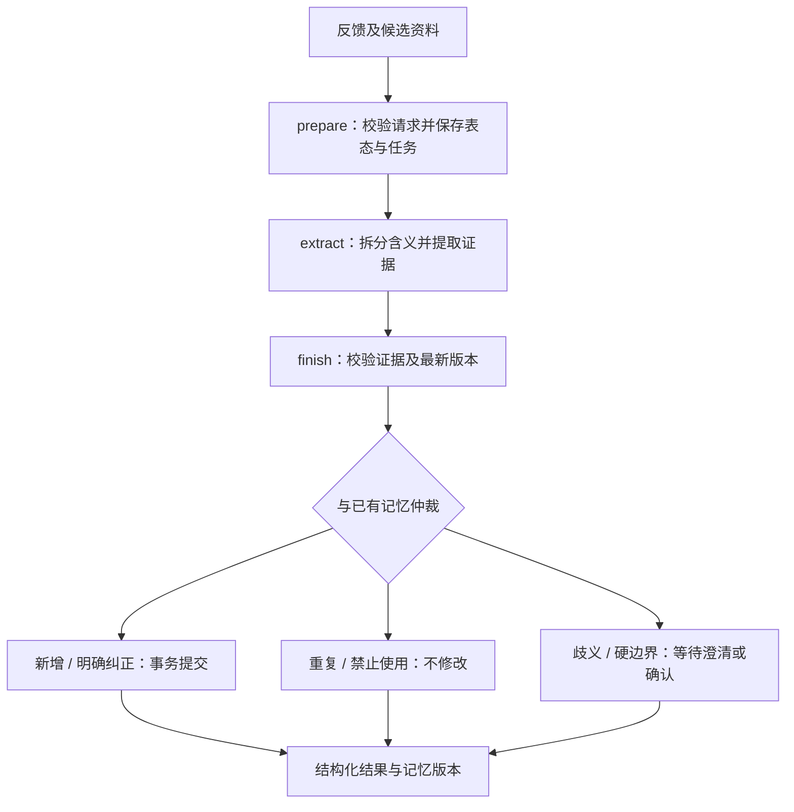

# Feedback Memory · 反馈到长期记忆

从推荐反馈中识别长期偏好，保留原话证据，通过冲突仲裁和版本检查更新记忆。

例如，用户说“我本人喜欢朋友聚会，但我希望伴侣周末安静一点”，程序分别保存自身特点与伴侣期待。用户明确改变期待时，新记忆替代旧版本；临时状态、单人评价不会自动变成长期偏好。

**状态：本地可运行的算法实验。** 29 项自动化测试通过；提供 45 条虚构样本和本地规则基线对比。真实模型适配器已编写，尚未在线验证。这里的结果不代表生产效果或大模型语义能力。

## 安装与快速开始

Python 3.9+，本地模式仅使用标准库，无需 API 密钥。下载仓库并在根目录运行：

```sh
python3 -m unittest discover -s tests -v
python3 -m feedback_memory demo --case case-13
python3 -m feedback_memory evaluate --mode local --out reports/local
```

三个入口案例：`case-13` 明确纠正、`case-16` 硬边界待确认、`case-21` 区分自身与伴侣期待。`case-45` 展示跨轮指代失败。

## 架构与流程



| 模块 | 作用 |
|---|---|
| `feedback_memory/cli.py` | 演示、提交、查询、确认、撤销、重试、评测入口 |
| `feedback_memory/extractors.py` | 本地规则提取器及可配置模型适配器 |
| `feedback_memory/engine.py` | SQLite 事务、去重、仲裁、权限和版本保护 |
| `feedback_memory/evaluation.py` | 基线比较、指标计算、逐条结果与失败分析 |
| `data/`、`tests/` | 虚构数据与自动化测试 |

## 核心功能

- 同一反馈可包含多个独立含义，分别提取证据。
- 重复信息不产生重复记忆；明确纠正替代旧版；不同情境允许并存。
- 未确认硬边界保持待定；明确软偏好在实验规则下自动采用。
- 表态撤改使关联待采用提案失效，已采用偏好不随单次表态自动撤销。
- 提交时同时检查反馈修订版本与记忆版本，旧结果不能覆盖新纠正。
- 禁止使用的记忆及同属性、同情境的派生修订不重新用于匹配。

## 本地评测

45 条合成样本：开发集 24 条、预留集 21 条，由同一作者编写，**不是独立盲测**。下表是预留集结果；两条路线共用仲裁器。

| 指标 | 单含义规则基线 | 多含义规则提取 |
|---|---:|---:|
| 分类 micro F1 | 0.6522 | 0.7843 |
| 长期提案 Recall | 0.5000 | 0.8333 |
| 冲突与纠正正确率 | 0.6667 | 0.8333 |
| 错误长期写入 / 实际写入 | 1 / 6 | 0 / 9 |

小样本中未出现错误写入，不等于对任意表达有保证。复杂否定、隐含偏好和跨轮指代仍有失败。证据片段存在，也不代表它一定支持提案的语义。

[完整评测与失败案例](reports/local/REPORT.md) · [架构与采用规则](docs/ARCHITECTURE.md) · [运行与模型配置](docs/RUNBOOK.md)

## 文档与后续工作

- [架构与处理规则](docs/ARCHITECTURE.md)
- [运行、持久化与模型配置](docs/RUNBOOK.md)
- [评测结果与失败分析](reports/local/REPORT.md)

后续工作：接入真实模型并复测；增加独立复核样本；改进复杂否定、隐含偏好与跨轮指代；明确生产环境授权和属性映射。

## 范围与限制

支持七类实验属性。CLI 身份参数不是互联网多用户鉴权；新软偏好采用“已获内部匹配许可”的虚构前提，公开权限默认关闭。SQLite 任务可恢复，但没有常驻任务调度器。未包含推荐排序、生产部署、模型微调或真实用户数据。

不预设开源许可证；公开发布不等于授予任意复用许可，许可证由项目所有者确认后补充。
